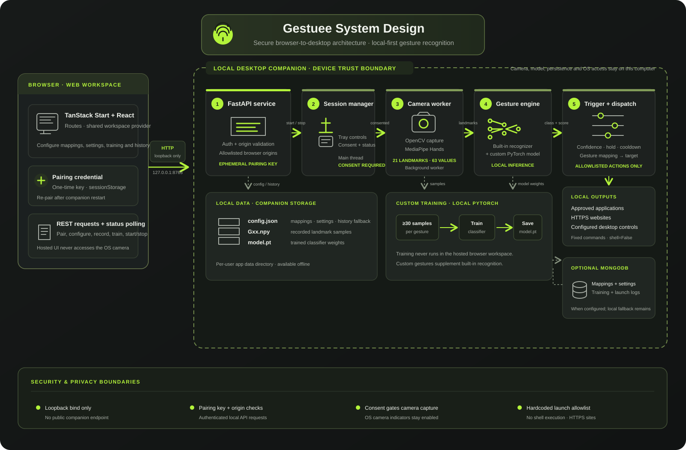
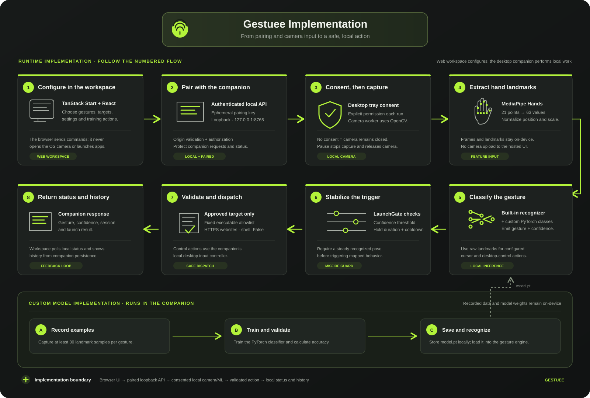

# Gestuee

Control your apps with hand gestures. Train a local PyTorch model on your own hand signs, then launch apps and websites with a wave — all processing stays on your device.

## How it works

- **Web UI** — configure gestures, record training samples, monitor sessions, and view history
- **Desktop companion** — runs locally in the background, operates your camera and trained model, and launches approved apps

## System design



## Implementation



## Getting started

1. Download the Gestuee companion from the Settings page
2. Follow the setup instructions for your OS (Windows / macOS / Linux)
3. Pair the companion using the key shown on first launch
4. Record ≥30 samples per gesture, train the model, then start a session

## Development

Requires Node.js 20+.

```sh
git clone <this-repository-url>
cd <repository-name>
npm install
npm run dev
```

## Built with

- TanStack Start + Router
- React 19
- TypeScript
- Tailwind CSS 4
- FastAPI + PyTorch (companion)
- MediaPipe (hand landmark detection)

## References

These sources document the research and libraries used by Gestuee's implementation:

1. Bazarevsky, V. et al. (2020). [MediaPipe Hands: On-device Real-time Hand Tracking](https://arxiv.org/abs/2006.10214). *CVPR Workshop on Computer Vision for Augmented and Virtual Reality*. Foundation for the on-device hand-landmark pipeline.
2. Google AI Edge. [MediaPipe Hand Landmarker](https://ai.google.dev/edge/mediapipe/solutions/vision/hand_landmarker). Official task documentation for hand landmark detection.
3. PyTorch. [`torch.nn`](https://docs.pytorch.org/docs/stable/nn.html). Neural-network building blocks used for Gestuee's locally trained gesture classifier.
4. OpenCV. [`cv::VideoCapture`](https://docs.opencv.org/4.x/d8/dfe/classcv_1_1VideoCapture.html). Camera and video capture API used by the desktop companion.
5. FastAPI. [FastAPI documentation](https://fastapi.tiangolo.com/). Python framework used for the companion's local API.
6. TanStack. [TanStack Start overview](https://tanstack.com/start/latest/docs/framework/react/overview). Framework documentation for the web workspace.

Gestuee's custom classifier is trained locally from samples recorded by the user; it is not a pretrained license-plate or object-detection model.
